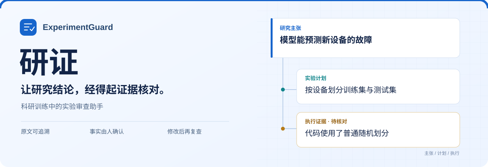
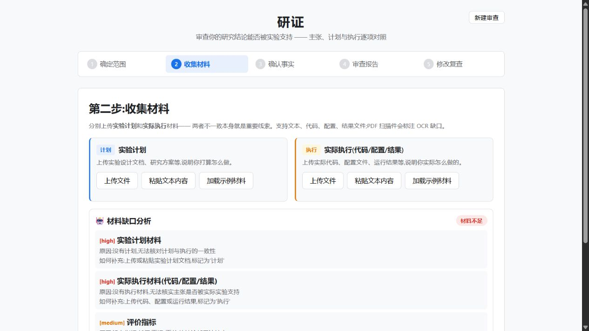
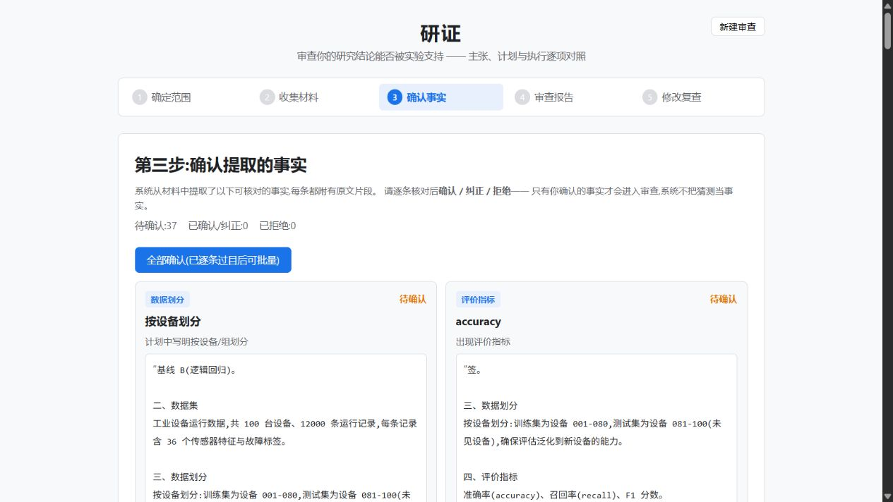
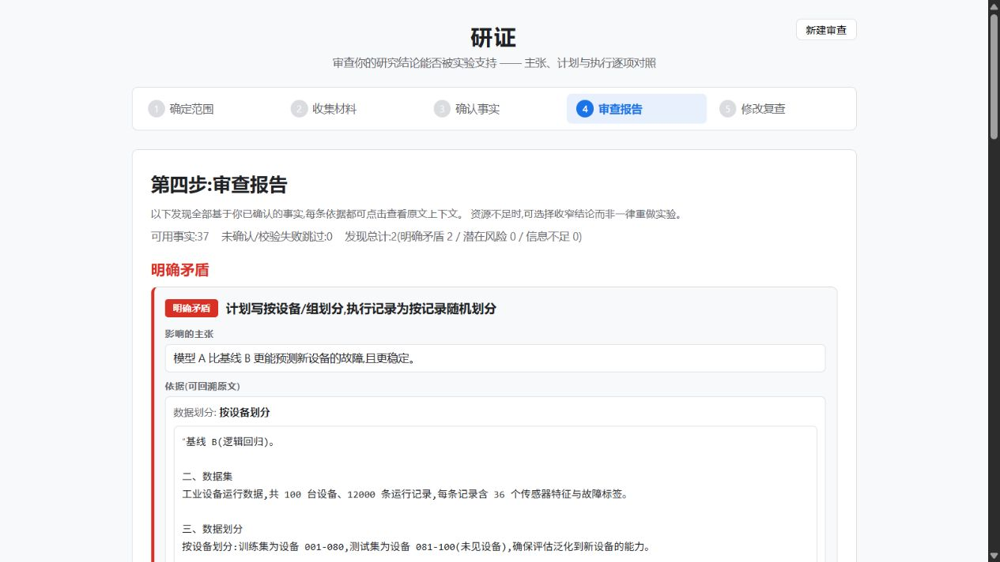
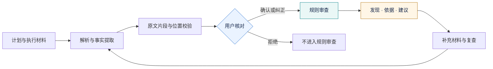

<p align="center">
  
</p>

<p align="center">
  <strong>科研训练中的实验审查助手</strong><br />
  从研究主张出发，核对实验计划、执行材料与结论之间的证据关系。
</p>

<p align="center">
  
  
  
  
  
</p>

<p align="center">
  <a href="#界面预览">界面预览</a> ·
  <a href="#一个具体例子">具体例子</a> ·
  <a href="#五步完成一次审查">使用流程</a> ·
  <a href="#本地启动">本地启动</a> ·
  <a href="docs/architecture.md">架构说明</a> ·
  <a href="#当前实现与边界">实现边界</a>
</p>

---

## 研证可以帮你做什么

学生提出研究主张，上传实验计划、代码或运行记录。研证提取带原文位置的候选事实，经用户确认后执行审查，列出问题依据、受影响的主张、缺失证据和修改建议。

它面向本科选题、课程项目和科研入门中的实验训练，帮助学生检查“我做的实验，能支持我写下的结论吗？”。当前规则覆盖**数据与模型实验**、**算法与系统性能实验**。

<table>
  <tr>
    <td width="33%" valign="top">
      <strong>原文可追溯</strong><br /><br />
      每条候选事实保留材料片段和字符位置，审查发现可以回到原文核对。
    </td>
    <td width="33%" valign="top">
      <strong>事实由人确认</strong><br /><br />
      用户确认、纠正或拒绝候选事实，普通规则审查只使用确认后的事实。
    </td>
    <td width="33%" valign="top">
      <strong>修改后再复查</strong><br /><br />
      补充材料后重新审查，对照仍触发和不再触发的问题，保留修改理由。
    </td>
  </tr>
</table>

## 界面预览

以下为当前版本使用内置示例材料的真实截图。截图在无模型配置的演示环境中生成。

<p align="center">
  
  <br /><sub>分别收集“打算怎么做”与“实际怎么做”，便于后续对照。</sub>
</p>

<details>
<summary><strong>查看事实确认与审查报告</strong></summary>

### 确认提取的事实



### 查看发现及其依据



截图展示的是当前规则的输出。线索的解释仍需结合完整材料核实，不能仅凭函数名断定数据泄漏。

</details>

## 一个具体例子

> **研究主张：** 模型 A 比基线 B 更能预测新设备的故障，且更稳定。

| 对照对象 | 材料中的信息 | 需要核实的问题 |
| :--- | :--- | :--- |
| **主张** | 目标是预测训练时未见过的新设备 | 测试设备是否确实独立于训练设备？ |
| **计划** | 按设备划分训练集与测试集 | 执行中是否保留了这个划分约束？ |
| **执行** | 出现 `train_test_split(X, y, ...)` | 输入是记录还是设备编号？两侧设备编号是否重叠？ |

研证把这些信息及其出处放在一起，提示用户核对真实划分过程，再决定补充证据、修改实验或收窄结论。**引用确实存在，不等于推断一定成立。**

## 五步完成一次审查

| 步骤 | 你来做 | 研证来做 |
| :--- | :--- | :--- |
| **01 确定范围** | 选择实验类型，逐条填写研究主张 | 分析主张需要哪些实验设计依据 |
| **02 收集材料** | 上传文件或粘贴内容，标记计划 / 执行 | 解析材料、提取候选事实、提示材料缺口 |
| **03 确认事实** | 查看原文，确认、纠正或拒绝 | 保存状态，筛选普通规则审查可用的事实 |
| **04 审查报告** | 查看发现、证据和修改建议 | 区分明确矛盾、潜在风险、信息不足；提供模型复核入口 |
| **05 修改复查** | 补充材料并填写修改理由 | 重新运行规则，对比前后报告 |

可加载示例主张和示例材料体验流程。报告支持 **Markdown 导出**，并可生成教学小案例供学生练习判断；当前页面已完成的模型深度复核结果也会包含在导出中。

## 从材料到发现的证据链



普通规则审查与模型辅助分析有各自的输入路径。深度复核会直接读取部分材料文本，其输出独立于普通规则报告；具体处理方式见[架构说明](docs/architecture.md)。

## 免费演示部署

[部署到 Render](https://render.com/deploy?repo=https%3A%2F%2Fgithub.com%2FlWinsonl%2FYanzheng-ExperimentGuard) · [查看部署说明](docs/deployment.md)

已提供 React + FastAPI 的单容器部署配置，固定选择免费实例。账号中完成部署后，队友可以通过云端 HTTPS 地址体验；免费实例会休眠，会话使用临时存储。默认不启用模型 API 调用。部署入口不是已经上线的演示地址，实际地址以平台部署结果为准。

## 本地启动

需要 **Python 3.10+**、**Node.js 22.12+** 和 npm。以下命令从仓库根目录开始执行。

### 1. 获取项目

```bash
git clone https://github.com/lWinsonl/Yanzheng-ExperimentGuard.git
cd Yanzheng-ExperimentGuard
```

### 2. 启动后端

```bash
cd backend
python -m pip install -r requirements.txt
python -m uvicorn app.main:app --host 127.0.0.1 --port 8002 --reload
```

### 3. 启动前端

另开一个终端，从仓库根目录执行：

```bash
cd frontend
npm ci
npm run dev
```

| 入口 | 本地地址 |
| :--- | :--- |
| 前端界面 | [localhost:5173](http://localhost:5173) |
| 后端接口文档 | [127.0.0.1:8002/docs](http://127.0.0.1:8002/docs) |

前端默认将 `/api` 转发至 `127.0.0.1:8002`。打开页面后，点击**加载示例**创建会话，再在收集材料页分别加载并提交示例计划与执行材料。

<details>
<summary><strong>可选：接入模型与启用 PDF 解析</strong></summary>

参考 [`backend/.env.example`](backend/.env.example)，在 `backend/.env` 中设置：

```dotenv
LLM_API_KEY=你的密钥
LLM_BASE_URL=兼容服务的接口地址
LLM_MODEL=服务提供的模型名称
```

密钥仅放在后端配置中，不要提交到仓库。

基础流程可在无模型配置时运行：方向分析、材料缺口、追问和教学案例会采用启发式或预设内容，深度复核返回空结果。配置兼容模型服务后，模型事实提取会尝试补充规则未覆盖的事实，并校验原文引用与去重；模型调用失败时回退到规则提取。

PDF 文本提取需要另行安装可选依赖：

```bash
python -m pip install pypdf
```

</details>

## 支持的材料

| 材料 | 当前处理方式 |
| :--- | :--- |
| 文本、Markdown、代码、配置、CSV、日志 | 按文本解析并建立字符位置索引 |
| Jupyter Notebook | 提取各单元格源码，再建立位置索引 |
| 含文本层的 PDF | 安装 `pypdf` 后提取文本，无法读取的内容提示缺口 |
| DOCX、XLSX、扫描件 OCR | 暂未实现对应解析器 |

文件选择框目前未限制扩展名，能选中文件不代表能正确解析。材料会发送到 Python 后端并写入 `data/`；调用模型分析时，相关材料或事实也可能发送到所配置的模型服务。

## 当前实现与边界

| 模块 | 已有能力 | 仍需完善 |
| :--- | :--- | :--- |
| 数据与模型规则 | 划分一致性、泛化范围、重复运行、基线、指标 | 关键词规则的解释强度与执行证据要求 |
| 算法与系统规则 | 基线、性能指标、稳定性重复运行、材料完整性 | 更广泛的系统实验情境与实际案例验证 |
| 模型辅助分析 | 事实提取、方向、缺口、追问、深度复核、教学案例 | 复核引用未完整绑定声明文件；引用失败时仍可能保留无引用的建议 |
| 会话保存 | JSON 写入与启动恢复，前端会话记忆、历史入口 | 写入失败与损坏文件的可见反馈 |
| 修改复查 | 按规则标识比较前后报告 | 材料版本、替换失效及多条发现的准确配对 |
| 报告导出 | 导出规则发现、证据、建议、追问及当前页面的模型复核结果 | 模型复核结果尚未持久化到后端报告 |

当前为科研训练原型。未发现问题不能解读为实验已全面通过审查；已有免费演示部署配置，但尚无用户隔离和上传配额。更详细的代码分析见[架构与待完善项](docs/architecture.md)。

<details>
<summary><strong>项目结构</strong></summary>

```text
Yanzheng-ExperimentGuard/
├── backend/
│   ├── app/
│   │   ├── api/          会话、材料、事实、审查、复查接口
│   │   ├── parsers/      文本、代码、Notebook、PDF 解析
│   │   ├── extractors/   规则与模型事实提取
│   │   ├── models/       主张、事实、原文锚点、报告模型
│   │   ├── rules/        数据模型与算法系统实验规则
│   │   ├── services/     证据链、审查、复查、JSON 存储
│   │   └── agent/        模型客户端、提示词、辅助分析
│   └── tests/
├── frontend/
│   └── src/
│       ├── pages/        五步工作流
│       ├── components/   事实卡片、引用、发现、教学案例
│       ├── api/          后端接口客户端
│       └── types/        TypeScript 数据类型
└── docs/
    ├── architecture.md  架构与实现边界
    └── images/          README 封面与真实界面截图
```

</details>

<details>
<summary><strong>验证、构建与部署说明</strong></summary>

```bash
# backend 目录
python -m pip install pytest
python -m pytest tests -q

# frontend 目录
npm run build
```

测试覆盖引用校验、确认流程、数据模型规则、算法系统规则、复查与无模型模式。测试通过不等于审查准确率已得到实际研究案例验证。

前端产物在 `frontend/dist/`。正式部署还需要 Python 后端及 `/api` 转发，单独发布静态前端无法完成上传和审查。

</details>

---

<p align="center">
  <strong>研证 · ExperimentGuard</strong><br />
  <sub>研究主张有边界，审查判断有出处。</sub>
</p>
