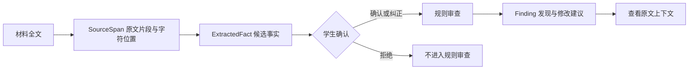

<div align="center">

# 研证 · ExperimentGuard

**让研究主张、实验设计和执行证据对应起来。**

科研训练中的实验审查原型 · React + TypeScript · FastAPI + Python

[使用流程](#使用流程) · [本地启动](#本地启动) · [代码架构](./docs/architecture.md) · [能力边界](#能力边界)

</div>

---

学生写下研究主张，上传实验计划、代码或运行记录。研证提取带原文位置的候选事实，经学生确认后执行审查，展示问题依据、影响的主张、缺少的证据和修改建议。

例如：主张涉及“新设备”，计划写按设备划分，执行材料却出现普通随机划分代码。系统将这几处信息放在一起，供学生核对真实划分过程和结论适用范围。

## 使用流程

| 步骤 | 学生操作 | 系统提供 |
| --- | --- | --- |
| 1 · 确定范围 | 选择实验类型，逐条填写研究主张 | 分析主张需要哪些实验设计依据 |
| 2 · 收集材料 | 上传文件或粘贴内容，标记“计划 / 执行” | 解析材料、提取候选事实、提示材料缺口 |
| 3 · 确认事实 | 查看原文，确认、纠正或拒绝事实 | 保存事实状态，普通规则审查只使用已确认或纠正的事实 |
| 4 · 审查报告 | 查看发现及其证据 | 展示明确矛盾、潜在风险、信息不足；可另外请求模型复核 |
| 5 · 修改复查 | 补充材料、确认新事实，填写修改理由 | 对比新旧报告，显示不再触发与仍待核实的发现 |

报告还提供教学小案例，让学生先判断，再展开提示和参考思路。

## 证据怎样追溯



原文引用在入库前逐字校验。这个校验能确认“引用确实存在”，但不能单独证明事实解释或审查判断正确；人工确认和规则质量仍然重要。

## 本地启动

需要 Python 3.10+、Node.js 22.12+ 和 npm。先启动后端，再启动前端。

**后端**

```bash
cd backend
python -m pip install -r requirements.txt
python -m uvicorn app.main:app --host 127.0.0.1 --port 8001 --reload
```

PDF 文本提取使用可选依赖 `pypdf`，需要时另行安装：

```bash
python -m pip install pypdf
```

**前端：另开一个终端**

```bash
cd frontend
npm ci
npm run dev
```

打开终端显示的地址，默认是 `http://localhost:5173`。开发服务器会把 `/api` 转发到 `http://127.0.0.1:8001`。后端接口文档位于 `http://127.0.0.1:8001/docs`。

**模型配置可选**：参考 [`backend/.env.example`](./backend/.env.example)，在后端 `.env` 中配置 `LLM_API_KEY`、`LLM_BASE_URL`、`LLM_MODEL`。基础流程可在无模型配置时运行；方向分析、缺口分析、追问及教学案例会采用启发式或预设内容，深度复核返回空结果。事实提取中的模型接口目前仍为预留实现，即使配置密钥也不会调用模型提取事实。

## 材料支持

- 文本与 Markdown、常见代码、JSON / YAML 等配置、CSV / 日志：按文本解析。
- Jupyter Notebook：提取各单元格源码，再建立字符位置索引。
- PDF：安装 `pypdf` 后提取文本层；无法读取的页面会提示内容缺口。
- 当前没有 DOCX、XLSX 和扫描件 OCR 解析器。文件选择框尚未限制扩展名，选中某格式不代表系统能正确读取它。

材料会发送到 Python 后端，并写入后端的 `data/` 目录。调用模型分析时，相关材料或事实也可能发送到所配置的模型服务。这与旧版浏览器本地解析的行为不同。

## 能力边界

| 模块 | 当前状态 |
| --- | --- |
| 数据与模型规则 | 已实现划分一致性、泛化范围、重复运行、基线、指标这五类规则 |
| 算法与系统性能规则 | 页面可选，但尚未实现对应规则，空报告不能解读为通过审查 |
| 模型辅助分析 | 已有兼容接口客户端；模型失败时部分功能回退到启发式结果 |
| 模型事实提取 | 引用校验与数据结构已写好，实际模型调用尚未接通 |
| 会话保存 | 会写入 JSON；尚未实现启动时从文件恢复，刷新前端也会丢失当前会话入口 |
| 修改复查 | 按规则标识对比报告；材料尚无替换/失效机制，新旧执行事实可能同时存在 |

这是科研训练原型。部分规则仍依赖关键词，存在把代码线索判断得过强的风险。深度复核的引用校验目前也未完整绑定到模型声明的文件。完整说明见[架构与待完善项](./docs/architecture.md)。

## 验证与构建

```bash
# backend 目录；在未配置真实模型密钥的测试环境中运行
python -m pip install pytest
python -m pytest tests -q

# frontend 目录
npm run build
```

测试覆盖事实引用、确认流程、数据模型规则、复查与无模型模式。测试通过不等于审查准确率已得到实际研究案例验证。

## 项目结构

```text
backend/
  app/api/          会话、材料、事实、审查、复查和模型接口
  app/parsers/      文本、代码、Notebook 与 PDF 解析
  app/extractors/   规则提取与预留模型提取
  app/models/       主张、事实、原文锚点和报告模型
  app/rules/        数据与模型实验规则
  app/services/     证据链、审查、复查与 JSON 存储
  app/agent/        模型客户端、提示词和辅助分析
  tests/            现有测试
frontend/
  src/pages/        五步工作流
  src/components/   事实卡片、证据引用、发现和教学案例
  src/api/          后端接口客户端
  src/types/        与后端对应的 TypeScript 类型
```

前端构建文件位于 `frontend/dist/`。正式部署还需要 Python 后端及 `/api` 转发；单独发布静态前端无法完成上传和审查。当前尚无用户隔离、上传配额和生产部署配置，不宜直接作为开放的多人服务运行。
