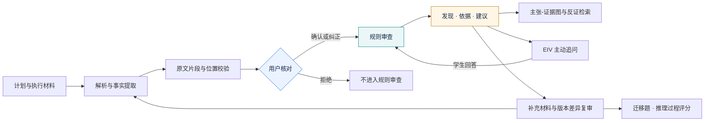

<p align="center">
  
</p>

<p align="center">
  <strong>科研训练中的实验审查助手</strong><br />
  从研究主张出发，核对实验计划、执行材料与结论之间的证据关系。
</p>

<p align="center">
  
  
  
  
  
</p>

<p align="center">
  <a href="#三个差异化能力">差异化能力</a> ·
  <a href="#界面预览">界面预览</a> ·
  <a href="#一个具体例子">具体例子</a> ·
  <a href="#五步完成一次审查">使用流程</a> ·
  <a href="#本地启动">本地启动</a> ·
  <a href="docs/architecture.md">架构说明</a> ·
  <a href="#当前实现与边界">实现边界</a>
</p>

---

## 研证可以帮你做什么

学生提出研究主张，上传实验计划、代码或运行记录。研证提取带原文位置的候选事实，经用户确认后执行审查，列出问题依据、受影响的主张、缺失证据和修改建议。

它面向本科选题、课程项目和科研入门中的实验训练，帮助学生检查“我做的实验，能支持我写下的结论吗？”。当前规则覆盖**数据与模型实验**、**算法与系统性能实验**。

<table>
  <tr>
    <td width="33%" valign="top">
      <strong>原文可追溯</strong><br /><br />
      每条候选事实保留材料片段和字符位置，审查发现可以回到原文核对。
    </td>
    <td width="33%" valign="top">
      <strong>事实由人确认</strong><br /><br />
      用户确认、纠正或拒绝候选事实，普通规则审查只使用确认后的事实。
    </td>
    <td width="33%" valign="top">
      <strong>修改后再复查</strong><br /><br />
      补充材料后重新审查，对照仍触发和不再触发的问题，保留修改理由。
    </td>
  </tr>
</table>

## 三个差异化能力

在基础证据链审查之外，研证围绕以下三个方向实现研究训练流程；其差异化价值仍需通过同条件评测验证：

<table>
  <tr>
    <td width="33%" valign="top">
      <strong>主张—证据图与反证检索</strong><br /><br />
      把每条研究主张拆成子主张，用确定性规则建立子主张与证据的连接，再由模型补充候选边（附原文引用，待人工核对）。检索反证时区分"找到反证 / 缺失反证 / 未知"三态，而不是只报"不支持"。
    </td>
    <td width="33%" valign="top">
      <strong>基于预期信息价值的主动追问</strong><br /><br />
      不是列一张固定的问题清单，而是为每个候选追问计算预期信息价值（EIV = 严重度 × 不确定性 × 改变概率 ÷ 回答成本），按"回答哪个问题最可能改变审查结论"排序，并解释为何先问这个。回答先保存为带出处的补充材料，提取事实后由用户确认或拒绝，再重新审查并展示发现变化；口头说明不能替代独立执行记录。
    </td>
    <td width="33%" valign="top">
      <strong>版本差异复审与学习迁移评估</strong><br /><br />
      修改实验后，按规则、主张与明确作用范围配对前后发现，判定"已解决 / 缓解 / 仍存在 / 新问题 / 证据不足"五态；配对歧义或缺快照时保留不确定。依据完整事实快照核对修改理由，不能把类别变化当作修正有效。再生成<strong>不同表面情境、同一方法要点</strong>的迁移题，按推理过程四维给参考反馈；无有效模型评分时只给自查建议。
    </td>
  </tr>
</table>

## 界面预览

以下为当前版本使用内置示例材料的真实截图。截图在无模型配置的演示环境中生成，尚未更新为本次流程调整后的界面。

<p align="center">
  
  <br /><sub>分别收集“打算怎么做”与“实际怎么做”，便于后续对照。</sub>
</p>

<details>
<summary><strong>查看事实确认与审查报告</strong></summary>

### 确认提取的事实


### 查看发现及其依据


截图保留了早期版本界面，仅用于展示基本流程；当前报告页采用逐步展开，复查与迁移练习集中在第五步。线索的解释仍需结合完整材料核实，不能仅凭函数名断定数据泄漏。

</details>

## 一个具体例子

> **研究主张：** 模型 A 比基线 B 更能预测新设备的故障，且更稳定。

| 对照对象 | 材料中的信息 | 需要核实的问题 |
| :--- | :--- | :--- |
| **主张** | 目标是预测训练时未见过的新设备 | 测试设备是否确实独立于训练设备？ |
| **计划** | 按设备划分训练集与测试集 | 执行中是否保留了这个划分约束？ |
| **执行** | 出现 `train_test_split(X, y, ...)` | 输入是记录还是设备编号？两侧设备编号是否重叠？ |

研证把这些信息及其出处放在一起，提示用户核对真实划分过程，再决定补充证据、修改实验或收窄结论。**引用确实存在，不等于推断一定成立。**

## 五步完成一次审查

| 步骤 | 你来做 | 研证来做 |
| :--- | :--- | :--- |
| **01 确定范围** | 选择实验类型，逐条填写研究主张 | 分析主张需要哪些实验设计依据 |
| **02 收集材料** | 上传文件或粘贴内容，标记计划 / 执行 | 解析材料、提取候选事实、提示材料缺口 |
| **03 确认事实** | 查看原文，确认、纠正或拒绝 | 保存状态，筛选普通规则审查可用的事实 |
| **04 审查报告** | 查看发现、证据和修改建议；按 EIV 排序回答追问 | 区分明确矛盾、潜在风险、信息不足；提供主张—证据图、模型复核与追问排序 |
| **05 修改复查** | 补充材料并填写修改理由；作答迁移题 | 重新审查并按稳定身份对比前后报告（五态判定 + 理由对照）；生成迁移题并按推理过程四维评分 |

可加载示例主张和示例材料体验流程。报告页提供**主张—证据图**（可校准子主张-证据连接与反证检索）、**EIV 主动追问**（按预期信息价值排序，回答后追踪发现变化）、**版本差异复审**（五态判定 + 修改理由对照 + 人工标签）和**迁移题测验**（不同情境同方法要点，四维推理评分）；报告支持 **Markdown 导出**，也可生成教学小案例供学生练习判断。

收集材料时支持“补充”或“替换旧版本”。新文件解析成功后才替换同角色材料和事实，并重置图、追问与迁移数据；**历史报告、事实快照及原文归档会保留**，供溯源和版本比较，尚不支持一键回滚。

## 从材料到发现的证据链



普通规则审查与模型辅助分析有各自的输入路径。深度复核会直接读取部分材料文本（长文档截取前段并在提示中标注未提供部分），其输出独立于普通规则报告；具体处理方式见[架构说明](docs/architecture.md)。

## 免费演示部署

[部署到 Render](https://render.com/deploy?repo=https%3A%2F%2Fgithub.com%2FlWinsonl%2FYanzheng-ExperimentGuard) · [查看部署说明](docs/deployment.md)

已提供 React + FastAPI 的单容器部署配置，固定选择免费实例。账号中完成部署后，队友可以通过云端 HTTPS 地址体验；免费实例会休眠，会话使用临时存储。本地 `.env` 不会自动迁移，模型配置需在 Render 环境变量中另行设置；未配置时使用规则模式。部署入口不是已经上线的演示地址，实际地址以平台部署结果为准。仓库根目录的 `Dockerfile` 为单容器同源部署，同样可用于其他支持容器的平台。

## 本地启动

需要 **Python 3.10+**、**Node.js 22.12+** 和 npm。以下命令从仓库根目录开始执行。

### 1. 获取项目

```bash
git clone https://github.com/lWinsonl/Yanzheng-ExperimentGuard.git
cd Yanzheng-ExperimentGuard
```

### 2. 启动后端

```bash
cd backend
python -m pip install -r requirements.txt
python -m uvicorn app.main:app --host 127.0.0.1 --port 8002 --reload
```

### 3. 启动前端

另开一个终端，从仓库根目录执行：

```bash
cd frontend
npm ci
npm run dev
```

| 入口 | 本地地址 |
| :--- | :--- |
| 前端界面 | [localhost:5173](http://localhost:5173) |
| 后端接口文档 | [127.0.0.1:8002/docs](http://127.0.0.1:8002/docs) |

前端默认将 `/api` 转发至 `127.0.0.1:8002`。打开页面后，点击**加载示例**创建会话，再在收集材料页分别加载并提交示例计划与执行材料。

<details>
<summary><strong>可选：接入模型与启用 PDF 解析</strong></summary>

参考 [`backend/.env.example`](backend/.env.example)，在 `backend/.env` 中设置：

```dotenv
LLM_API_KEY=你的密钥
LLM_BASE_URL=兼容服务的接口地址
LLM_MODEL=服务提供的模型名称
```

密钥仅放在后端配置中，不要提交到仓库。

基础流程可在无模型配置时运行：方向分析、材料缺口、追问和教学案例会采用启发式或预设内容，深度复核会明确提示未接入模型。配置兼容模型服务后，模型事实提取会尝试补充规则未覆盖的事实，并校验原文引用与去重；模型调用失败时回退到规则提取，深度复核在偶发超时后会自动重试一次。

PDF 文本提取需要另行安装可选依赖：

```bash
python -m pip install pypdf
```

</details>

## 支持的材料

| 材料 | 当前处理方式 |
| :--- | :--- |
| 文本、Markdown、代码、配置、CSV、日志 | 按文本解析并建立字符位置索引 |
| Jupyter Notebook | 提取各单元格源码，再建立位置索引 |
| 含文本层的 PDF | 安装 `pypdf` 后提取文本，无法读取的内容提示缺口 |
| DOCX | 读取正文与表格，未覆盖图片等内容会提示部分解析 |
| XLSX | 读取单元格与明确列名表格，不执行公式、不采纳公式缓存值 |
| 扫描件 OCR、图片及其他未知格式 | 扫描 PDF 提示缺口；不支持的上传格式明确拒绝 |

文件选择框和后端都校验支持格式；单文件上限 5 MB，解析失败不会移除原材料。材料发送到 Python 后端并写入 `data/`；调用模型时，相关材料或事实可能发送到所配置的服务。执行材料区域提供空白数值 CSV 模板，格式与判断范围见[数值材料说明](docs/numeric-results.md)。

## 本次可靠性改进

- 函数名、指标名、基线名和计划承诺不再直接成为“支持结论”的图关系。
- 上传明确的实体编号 JSON 后可核对交集，结论仅限定于所提供的列表。
- 追问形成“回答 → 原文材料 → 候选事实 → 用户裁决 → 重新审查 → 变化说明”的流程。
- 普通审查保留版本比较基准，材料替换后仍保留历史原文供溯源。
- 模型失效时不以关键词和篇幅评分；单次模型反馈也不再显示“已掌握”。
- 完整数值记录可核对限定点估计与样本标准差；方法、指标、条件或主张范围不符时保留未知。
- 复查采用完整事实快照，证据类别变化不再制造“旧问题已解决”；无变化也不会被称为理由一致。
- DOCX/XLSX 只读解析、非法上传拒绝、刷新恢复与前端异步状态均有相邻正反例或真实浏览器回归。

测试边界、编号材料格式、演示额度和比赛评测方法见 [可靠性与验证说明](docs/reliability-and-validation.md)。合成测试通过不等于真实审查准确率或学习效果已经得到验证。

## 系统测试与评测

2026-11-02 修复后：**171 项后端与评测测试通过，0 失败、0 XFAIL；9 项真实浏览器用例通过**。前端构建通过，静态检查 0 警告，本地回归发布门槛通过。详见[修复后报告](evaluation/reports/2026-11-02-fixed/summary.md)；[历史基线](evaluation/reports/2026-11-02/summary.md)保留原 120 通过、5 XFAIL 和能力空白，不覆盖旧结果。

- [修复后的测试报告](evaluation/reports/2026-11-02-fixed/summary.md)：日志、源码/数据指纹、逐案例结果。
- [结果复核备注](evaluation/reports/2026-11-02-fixed/manual-review.md)：修复范围、分数适用范围和未执行项。
- [系统测试与评测协议](docs/evaluation/plan.md)：同模型基线、必要消融、教师盲评、学生迁移测验与统计方法。
- [5 项缺陷修复记录](docs/evaluation/defects.md)：修复机制、相邻正反例和剩余验证项。
- [实际浏览器验收表](docs/evaluation/browser-acceptance.md)：9 项自动用例覆盖三种宽度；完整人工和线上验收另列。

公开合成开发集共 24 例，修复后三态判断与可判覆盖均为 24 例集合内的 100%，修复前分别为 50% 和 33.3%。这是针对已见开发案例补齐能力后的回归结果，**不是接入智谱后的全系统准确率，也不是教学效果结论**；不能再充当未知留出集。本轮没有调用真实模型或访问生产会话。

```bash
# 仓库根目录；先按 evaluation/README.md 安装开发依赖
python -m evaluation.run
# 发布门槛模式，包含本地真实浏览器交互
python -m evaluation.run --release-gate --browser
```

## 当前实现与边界

| 模块 | 已有能力 | 仍需完善 |
| :--- | :--- | :--- |
| 数据与模型规则 | 划分一致性、泛化范围、重复运行、基线、指标 | 关键词规则的解释强度与执行证据要求 |
| 算法与系统规则 | 基线、性能指标、稳定性重复运行、材料完整性 | 更广泛的系统实验情境与实际案例验证 |
| 主张—证据图 | 确定性规则构建子主张-证据连接；模型补充候选边并附原文引用（仍需核对推断）；反证检索区分找到 / 缺失 / 未知三态 | 候选边质量依赖模型；图结构未持久化到导出报告 |
| 主动追问 | EIV 可解释评分排序（严重度 × 不确定性 × 改变概率 ÷ 成本）；回答提取为待确认事实，裁决后重新审查并追踪变化；统计完成率与变化率 | EIV 因子权重为手工设定，未经大规模数据校准 |
| 版本差异复审 | 规则、主张和明确作用范围配对；完整事实快照；五态判定；修改理由对照；人工标签 | 旧快照缺失、配对歧义时保留未知；仍依赖事实覆盖率 |
| 学习迁移评估 | 生成不同表面情境、同一方法要点的迁移题；四维推理评分（识别问题 / 解释原因 / 提出修改 / 推理质量）；模型不可用时仅提供自查建议，各维与总分为空 | 迁移题情境多样性受预设模板限制 |
| 模型辅助分析 | 事实提取、方向、缺口、追问、深度复核、教学案例、候选边、迁移题生成与评分；复核区分调用与解析失败并自动重试 | 引用绑定指定文件，但仍需核对推断是否成立；引用失败时仅保留降为信息不足的待核实建议 |
| 会话保存 | JSON 临时文件替换写入与启动恢复，前端会话记忆、历史入口；追问、版本差异、迁移数据均持久化 | 写入失败时的用户可见反馈 |
| 修改复查 | 按稳定身份配对前后报告（五态判定）；材料替换保留历史报告供对比，清除图 / 追问 / 差异数据 | 未增加数据库事务与跨进程一致性保障 |
| 报告导出 | 导出规则发现、证据、建议、追问，以及当前页面的模型复核状态、覆盖范围和结果 | 版本差异与迁移结果尚未纳入导出 |

当前为科研训练原型。未发现问题不能解读为实验已全面通过审查。演示版已加入浏览器会话隔离、文件上限与基础调用配额；清除 Cookie 或换浏览器后无法访问原会话，旧无归属会话也不再公开读取。完整账号、班级协作和持久数据库尚未实现。更详细的代码分析见[架构与待完善项](docs/architecture.md)。

<details>
<summary><strong>项目结构</strong></summary>

```text
Yanzheng-ExperimentGuard/
├── backend/
│   ├── app/
│   │   ├── api/          会话、材料、事实、审查、追问、主张图、版本差异接口
│   │   ├── parsers/      文本、代码、Notebook、PDF、DOCX、XLSX 解析
│   │   ├── extractors/   规则与模型事实提取
│   │   ├── models/       主张、事实、报告、追问、主张图、版本差异模型
│   │   ├── rules/        数据模型与算法系统实验规则
│   │   ├── services/     证据链、审查、追问、主张图、版本差异、JSON 存储
│   │   └── agent/        模型客户端、提示词、EIV 追问、迁移题生成与评分
│   ├── tests/            原有规则与可靠性回归
│   └── system_tests/     全流程、故障注入、缺陷与相邻正反例
├── frontend/
│   └── src/
│       ├── pages/        五步工作流
│       ├── components/   事实卡片、发现、主张图、追问、版本差异、迁移测验
│       ├── api/          后端接口客户端
│       └── types/        TypeScript 数据类型
└── docs/
    ├── architecture.md  架构与实现边界
    └── images/          README 封面与真实界面截图
```

</details>

<details>
<summary><strong>验证、构建与部署说明</strong></summary>

```bash
# backend 目录
python -m pip install pytest
python -m pytest tests -q

# frontend 目录
npm run build
```

完整检查请在仓库根目录运行 `python -m evaluation.run --release-gate --browser`。它包含原有回归、系统故障与缺陷正反例、评分程序自检、前端构建与静态检查，以及本地隔离浏览器工作流。测试通过不等于真实科研审查准确率或教学效果已验证。

前端产物在 `frontend/dist/`。正式部署还需要 Python 后端及 `/api` 转发，单独发布静态前端无法完成上传和审查。

本机安装 Docker 后，可用仓库根目录的 `Dockerfile` 构建单容器镜像并验证同源部署：

```bash
docker build -t yanzheng-demo .
docker run --rm -p 8080:8080 yanzheng-demo
```

访问 `http://localhost:8080`，页面与 `/api` 由同一服务提供。

</details>

---

<p align="center">
  <strong>研证 · ExperimentGuard</strong><br />
  <sub>研究主张有边界，审查判断有出处。</sub>
</p>
